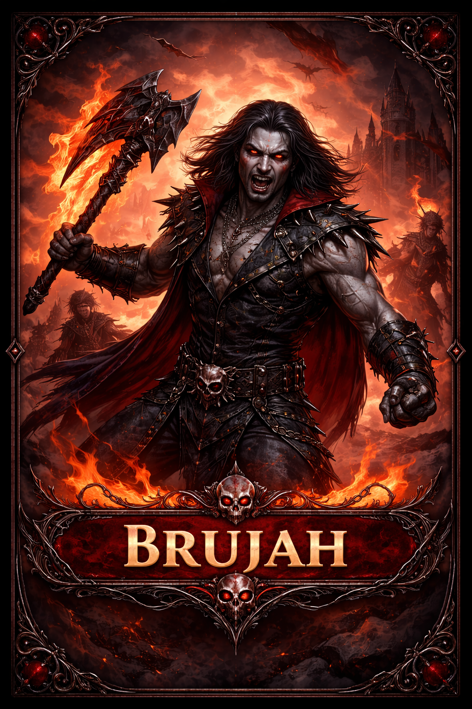
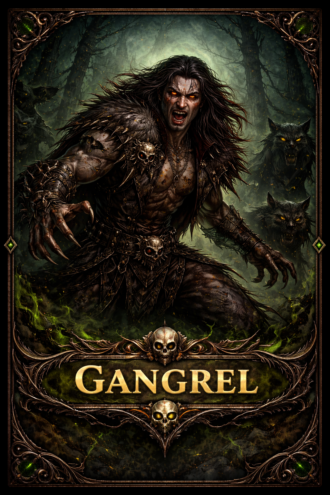
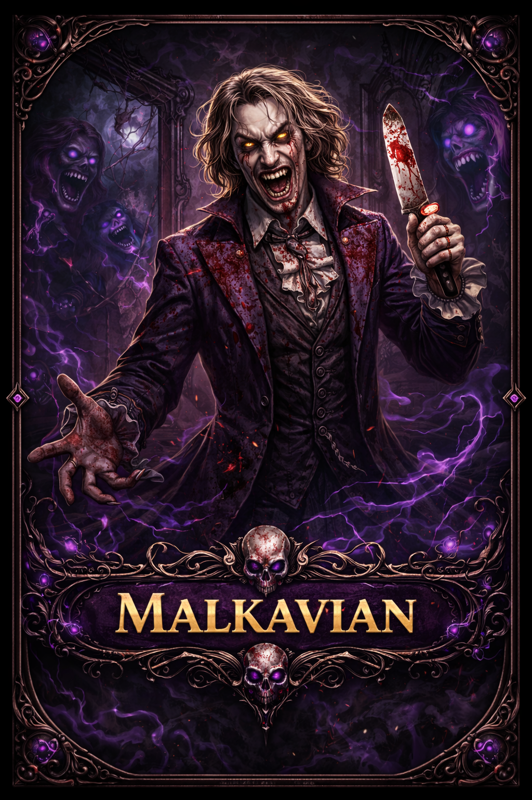
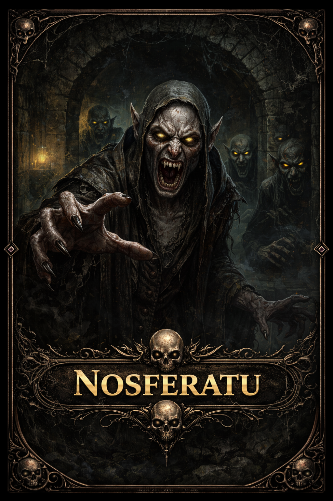
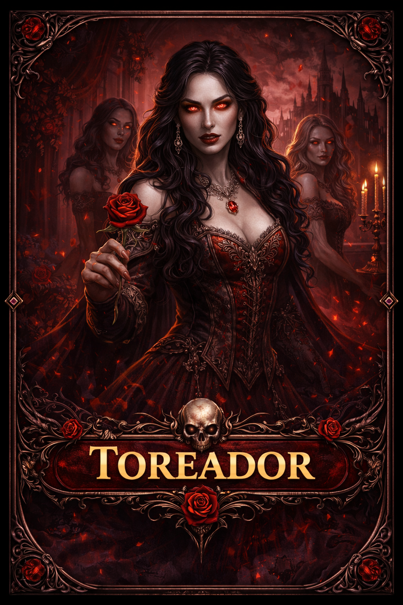
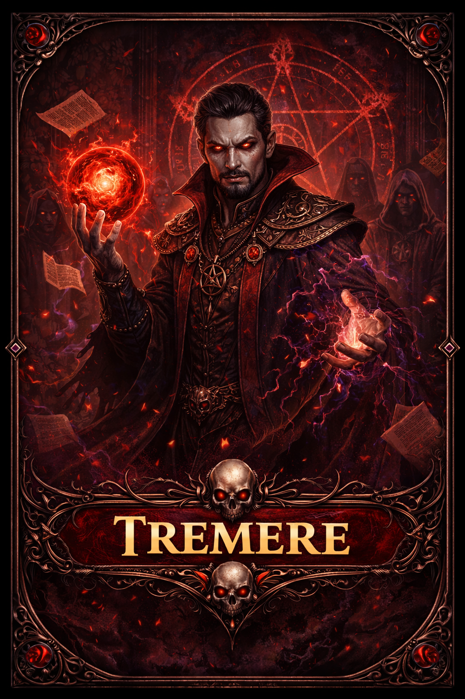
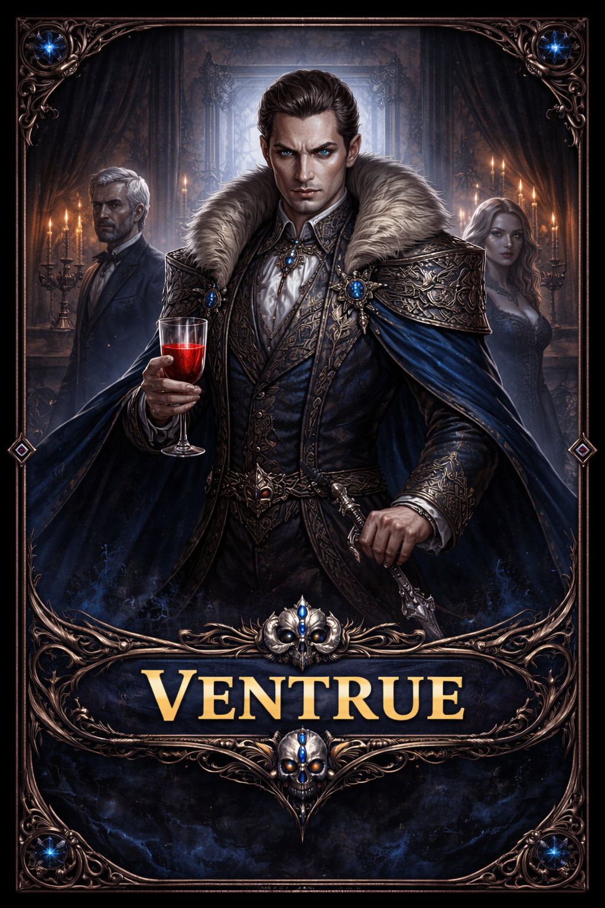

# Nocturne

Card game de vampiros para navegador, inspirado no universo de Vampiro: A Máscara, com elementos originais e mecânicas próprias.

## O jogo
Os jogadores colecionam vampiros de 7 clãs, montam decks e batalham pela supremacia na noite.

- **Brujah**: força bruta e fúria
- **Gangrel**: transformação e resistência
- **Malkavian**: loucura e manipulação mental
- **Nosferatu**: furtividade e espionagem
- **Toreador**: sedução e velocidade
- **Tremere**: magia de sangue
- **Ventrue**: dominação e liderança

## Destaques
- **Mais de 50 cartas** em 5 raridades (comum a lendária) e 4 tipos: vampiros, ações, eventos e equipamentos.
- **Partidas contra a IA** com 3 níveis de dificuldade, em turnos com fases e sangue como recurso.
- **Campo de batalha** com até 5 vampiros por lado.
- **Loja, pacotes e recompensas diárias**, com duas moedas.
- **Progressão**: níveis, coleção de cartas, perfil e histórico de partidas.

## Clãs

---

Este repositório é uma **vitrine** do projeto: mostra o que o jogo é e como ele é. O código-fonte não é público.

Desenvolvido por [@won3er](https://github.com/won3er).